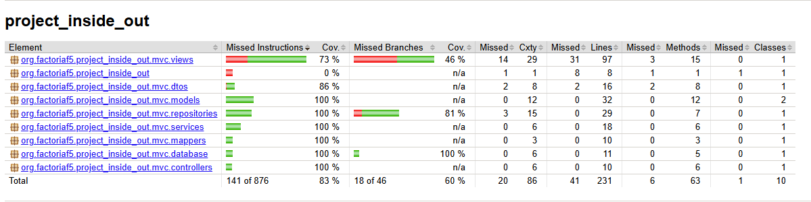
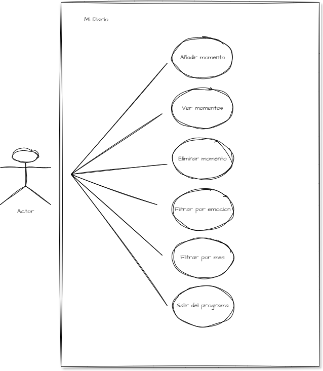
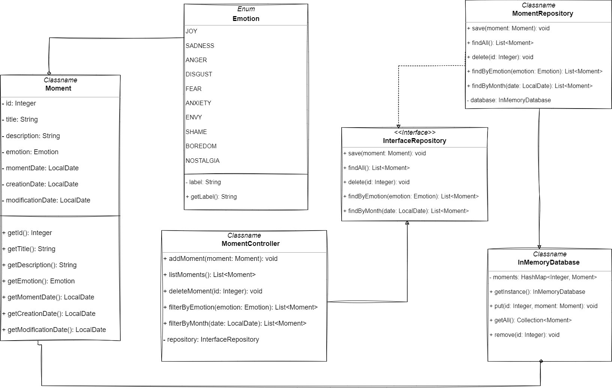
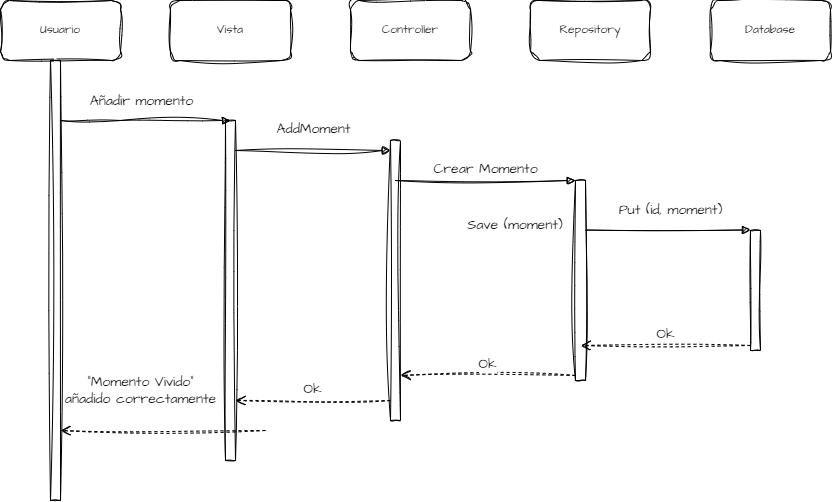

# Mi Diario — Inside Out

## Descripción

**Mi Diario** es una aplicación de consola desarrollada en Java que permite al usuario gestionar los momentos vividos a lo largo del tiempo. Cada momento vivido tiene asignada una emoción y una fecha concreta, y el usuario puede:

- Añadir un nuevo momento vivido
- Consultar la lista completa de momentos registrados
- Eliminar un momento existente por su identificador
- Filtrar los momentos por emoción
- Filtrar los momentos por mes

Cada momento vivido tiene un identificador, un título, una descripción, una emoción, la fecha del momento, la fecha de creación y la fecha de modificación.

### Listado de emociones
1. Alegría
2. Tristeza
3. Ira
4. Asco
5. Miedo
6. Ansiedad
7. Envidia
8. Vergüenza
9. Aburrimiento
10. Nostalgia

## Arquitectura del proyecto

El proyecto sigue una arquitectura en capas de tipo **MVC + Repository + Service + DAO**, siguiendo el flujo:

```
Vista (View) → Controlador (Controller) → Servicio (Service) → Repositorio (Repository) → DAO (InMemoryDatabase)
```

Cada capa tiene una única responsabilidad:

- **`MomentView`**: gestiona el menú y toda la interacción con el usuario por consola (lectura de teclado, impresión de resultados). No conoce el modelo de dominio (`Moment`), solo trabaja con `MomentDto`.
- **`MomentController`**: recibe las peticiones desde la vista y las delega en el `Service`. No contiene lógica de negocio.
- **`MomentService`**: aplica la lógica de negocio y hace de intermediario entre el mundo de DTOs (hacia la vista) y el mundo de modelos de dominio (hacia el repositorio), apoyándose en el `Mapper`.
- **`MomentRepository`**: implementa el contrato `InterfaceRepository`, aplicando las reglas de acceso a los momentos (guardar, buscar, filtrar), delegando el almacenamiento físico en el DAO.
- **`InMemoryDatabase`**: actúa como **DAO** (Data Access Object), implementando `InterfaceDatabase`. Es el único responsable de leer y escribir en el `HashMap` que guarda los momentos en memoria, sin conocer ninguna regla de negocio.
- **`MomentDto` / `MomentMapper`**: el DTO transporta los datos de un momento entre la vista y el resto de capas, sin exponer directamente el modelo de dominio (`Moment`). El `Mapper` convierte entre `Moment` y `MomentDto` en ambas direcciones.

## Principios y patrones aplicados

- **Encapsulación**: todos los atributos de las clases son privados, accesibles solo a través de getters (y, en los casos necesarios, un único setter controlado). Cada clase expone únicamente lo que el resto del sistema necesita conocer.
- **Abstracción**: `InterfaceRepository` e `InterfaceDatabase` definen *qué* operaciones existen sin especificar *cómo* se implementan, permitiendo que las clases concretas (`MomentRepository`, `InMemoryDatabase`) puedan sustituirse sin afectar al resto del sistema.
- **Inversión de Control (IoC)**: ninguna clase crea sus propias dependencias con `new` dentro de sí misma (salvo el propio `Singleton`). Las dependencias se inyectan siempre por constructor (`MomentController(MomentService)`, `MomentService(InterfaceRepository, MomentMapper)`...), decidiéndose desde `App.java`.
- **Refactorización**: el menú de la vista, que originalmente usaba un `switch`, se sustituyó por un mapa de acciones (`Map<Integer, Runnable>`) para reducir su complejidad ciclomática. La lógica de validación de rangos numéricos se extrajo a un único método reutilizable (`readIntInRange`).
- **Refinamiento**: iteraciones sucesivas sobre la vista para mostrar el identificador de cada momento, formatear las fechas de forma consistente, validar fechas futuras y comprobar la existencia de un identificador antes de eliminar.
- **Parametrización**: se usan tests parametrizados (`@ParameterizedTest` + `@MethodSource`) para comprobar las 10 emociones del enum `Emotion` y varios casos de filtrado por emoción en el repositorio, evitando duplicar tests casi idénticos.
- **Mockear**: se usa Mockito para simular `InterfaceRepository` en un test de `MomentController`, comprobando que se invoca el método esperado sin depender de una implementación real ni del estado compartido del Singleton.

## Persistencia de datos

Los momentos se almacenan en memoria mediante un `HashMap<Integer, Moment>`, encapsulado dentro de `InMemoryDatabase`, implementado como **Singleton de inicialización *Lazy*** (la instancia se crea la primera vez que se solicita, no al arrancar el programa). Se optó por `HashMap` en lugar de `TreeMap` porque ninguna historia de usuario exige un orden concreto de almacenamiento.

## Pre-requisitos

Para ejecutar este proyecto es necesario tener instalado:

- **Java 21** (JDK)
- **Maven** (3.6.3 o superior)
- **Git**

## Pasos para la instalación

1. Clona el repositorio (o tu fork) en tu equipo:

```bash
git clone https://github.com/AndreaVaGo/project-java-consoleapp-inside-out.git
```

2. Entra en la carpeta del proyecto:

```bash
cd project-java-consoleapp-inside-out
```

3. Instala las dependencias con Maven:

```bash
mvn install
```

4. Ejecuta el programa:

```bash
mvn compile exec:java -Dexec.mainClass="org.factoriaf5.project_inside_out.App"
```

## Historias de usuario y criterios de aceptación

### HU1 — Añadir un momento vivido
> COMO usuario QUIERO añadir un momento vivido PARA poder visualizarlo cuando lo necesite recordar

- **Dado** que el usuario está en el menú principal, **cuando** selecciona "Añadir momento" e ingresa título, fecha, descripción y emoción válidos, **entonces** el sistema muestra "Momento vivido añadido correctamente."
- **Dado** que el usuario está añadiendo un momento, **cuando** introduce un dato con formato inválido, **entonces** el sistema le vuelve a pedir ese mismo dato.

### HU2 — Ver todos los momentos
> COMO usuario QUIERO recuperar la lista de los momentos vividos registrados PARA poder repasarlos

- **Dado** que existen momentos registrados, **cuando** el usuario selecciona "Ver todos los momentos disponibles", **entonces** el sistema muestra la lista completa con id, fecha, título, descripción y emoción de cada uno.
- **Dado** que no existe ningún momento registrado, **cuando** el usuario selecciona esa opción, **entonces** el sistema informa de que no hay momentos disponibles.

### HU3 — Eliminar un momento
> COMO usuario QUIERO suprimir un momento vivido PARA evitar duplicados y mantener la lista de momentos organizada

- **Dado** que existe un momento con un identificador concreto, **cuando** el usuario selecciona "Eliminar un momento" e introduce ese identificador, **entonces** el sistema elimina el momento y muestra "Momento vivido eliminado correctamente."
- **Dado** que el usuario introduce un identificador que no existe, **cuando** confirma esa opción, **entonces** el sistema informa de que no existe ningún momento con ese identificador.

### HU4 — Filtrar por emoción
> COMO usuario QUIERO obtener los momentos vividos según su emoción PARA poder visualizarlos

- **Dado** que existen momentos con distintas emociones registradas, **cuando** el usuario selecciona "Filtrar" → "Emoción" y elige una emoción concreta, **entonces** el sistema muestra solo los momentos que tienen esa emoción asignada.
- **Dado** que ningún momento tiene la emoción seleccionada, **cuando** el usuario aplica ese filtro, **entonces** el sistema informa de que no hay momentos con esa emoción.

### HU5 — Filtrar por mes
> COMO usuario QUIERO obtener los momentos vividos en un mes determinado

- **Dado** que existen momentos registrados con distintas fechas, **cuando** el usuario selecciona "Filtrar" → "Fecha" e introduce una fecha completa, **entonces** el sistema muestra solo los momentos cuyo mes y año coinciden con los introducidos (ignorando el día).
- **Dado** que ningún momento pertenece a ese mes y año, **cuando** el usuario aplica ese filtro, **entonces** el sistema informa de que no hay momentos en ese periodo.

*Nota de diseño: se decidió comparar por mes y año (no por día exacto), siguiendo la propia redacción de la historia de usuario ("en un mes determinado").*

### HU6 — Salir del programa
> COMO usuario QUIERO salir del programa PARA poder iniciar otro

- **Dado** que el usuario está en el menú principal, **cuando** selecciona "Salir", **entonces** el sistema muestra "Hasta la próxima!!!" y finaliza la ejecución.

## Ejecución de los tests

Para ejecutar todos los tests del proyecto:

```bash
mvn test
```

Esto también genera un informe detallado de cobertura en `target/site/jacoco/index.html`.

### Cobertura de tests



Cobertura total alcanzada: **83% de instrucciones**, **60% de ramas** — superando el mínimo del 70% exigido. Todas las capas de dominio (`models`, `services`, `mappers`, `database`, `controllers`) alcanzan el 100% de cobertura de instrucciones; la capa `views` alcanza un 73%, al ser la más costosa de testear al depender de la interacción por consola.

## Diagramas

### Diagrama de casos de uso


### Diagrama de clases


### Diagrama de secuencia


## Autores

- Andrea (AndreaVaGo) — [repositorio del proyecto](https://github.com/AndreaVaGo/project-java-consoleapp-inside-out)
